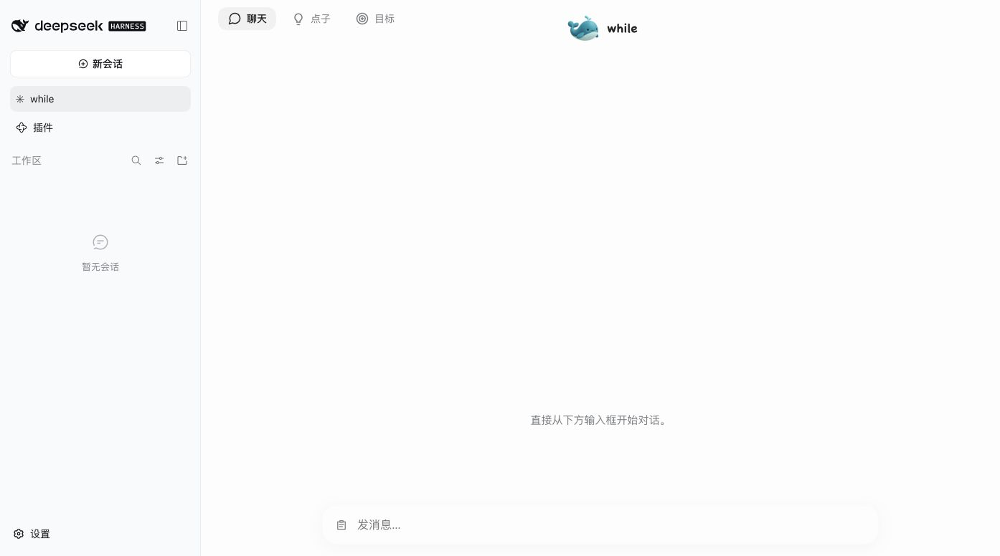

# while

**一个围绕你持续生长的个人 Agent。**

从你聊过的事里，发现下一件值得做的事。

[下载安装包](https://github.com/astrabrando-blip/dsh-while/releases/tag/v0.1.0-preview.2) · [反馈问题](https://github.com/astrabrando-blip/dsh-while/issues)

while 是 DeepSeek Harness 的全局助理插件。把持续对话、长期目标、点子和多个 Session 的协作放在一起。

## 39 秒认识 while

https://github.com/user-attachments/assets/973be501-50c2-4fff-ba9f-3a1358866a4e

## 能做什么

- **持续聊天**：保留同一个助理上下文，接着讨论之前的事情。
- **目标**：保存长期关注方向，直接修改、完成或删除；从历史里发现的目标先由你确认。
- **点子**：基于历史任务和目标，提出值得继续做的事情；必要时推荐复用、扩展或自建插件。
- **Session 协作**：查询其他工作区的任务、读取相关上下文，在你提出要求后新建或继续执行会话。
- **活动与产物**：查看工作进度和文件产物；深浅主题跟随宿主。

例如：你已经研究过一种 Agent 自进化机制，while 可以建议把它放到手头产品里做一次验证；你已有旅行攻略，它可以建议进一步整理成实际行程。点子是建议，不等于自动执行。

## 版本与兼容性

当前为 **0.1.0-preview.2 开发者预览版**。开发环境曾在 DSH Desktop **0.2.0-rc.2 / macOS** 验证主要功能。本发布包的独立安装验证状态见 [发布验证](docs/VALIDATION.md)。不承诺其他版本或平台已通过验证。DSH API 仍快速变化。

请不要与旧的 `@dsh-local/muse-desktop` 同时启用：两者使用相同服务和存储命名。保留 `muse` 内部名称是为了兼容已有数据，并非另一个产品。

## 安装

需要已安装 DSH CLI，并选定一个已有 **Web/Desktop profile**。下面的 `web` 是示例，请替换为你实际使用的 profile；不要把它理解为一定是桌面实例的 profile。

从 GitHub Release 下载预构建 `.tgz`，在下载目录运行：

```sh
dsh plugin --profile web add ./dsh-while-0.1.0-preview.2.tgz
```

然后重新启动对应的 DSH 实例，在侧栏打开 **while**。使用宿主中已配置的模型与账号，无需为插件单独粘贴密钥。

从源码 checkout 安装：

```sh
dsh plugin --profile web add ./dsh-while
```

本仓库包含运行所需的 JS，安装不依赖 `prepare` 或本机 monorepo。首次体验建议下载 Release 中的 `.tgz`；源码请使用本版本标签对应的完整源码。

卸载：`dsh plugin --profile web remove dsh-while`。移除插件不等于删除宿主中的历史或数据。

## 界面



真实独立安装截图，未植入演示聊天或虚构任务结果。

## 第一次使用

1. 说“帮我记一个目标：持续关注 Agent 自进化产品进展”。到目标页核对。
2. 聊聊你正在推进的真实任务，然后在点子页点“发现”，发送输入框中的请求。
3. 生成完成后回点子页。想继续时点“聊聊这个点子”，核对并发送；不合适可反馈或删除。
4. 需要处理多个任务时，直接说明要做什么、相关工作区和预期结果。

默认启用 while 主聊天，**自动发现关闭**；点击“发现”才请求生成。模型运行会使用宿主额度。默认配置在 `cordis.patch.yml`；DSH 的配置覆盖会替换整个 config，修改时保留需要的键。

## 数据与权限

插件在宿主权限范围内读取任务上下文，保存目标、反馈、记忆和工作关联。相关内容可能随模型请求发送到宿主配置的模型服务。查询公开插件目录还会访问 GitHub；不将私人聊天作为目录搜索参数。详见 [数据说明](docs/PRIVACY.md)。

预览版结果可能不准确，生成失败可重试；不要把会话空闲或回合结束直接理解为任务完成。文件上传入口和任意第三方插件的一键安装不属于本版承诺。

## 开发

Node.js 22+。`npm install` 后运行 `npm run check` 和 `npm test`。`npm pack` 生成预构建包。共享宿主依赖声明为 peers；独立测试使用 devDependencies。需要重建官方 Session surface 时运行 `npm run build:session-surface`，版本已固定。

代码使用 MIT；内嵌第三方代码与品牌素材见 [第三方说明](THIRD_PARTY_NOTICES.md)。本项目为社区插件，不代表 DeepSeek 官方。

## 反馈与参与

遇到安装失败、点子不相关或任务没有反馈，请在 [Issues](https://github.com/astrabrando-blip/dsh-while/issues) 告诉我们。建议附上 DSH 版本、系统、操作步骤、期望结果和实际结果；分享日志前请移除密钥和私人聊天。

有用的点子也欢迎分享：你原本在做什么、while 提出了什么、你接下来做了什么。真实使用会决定下一步改进。
